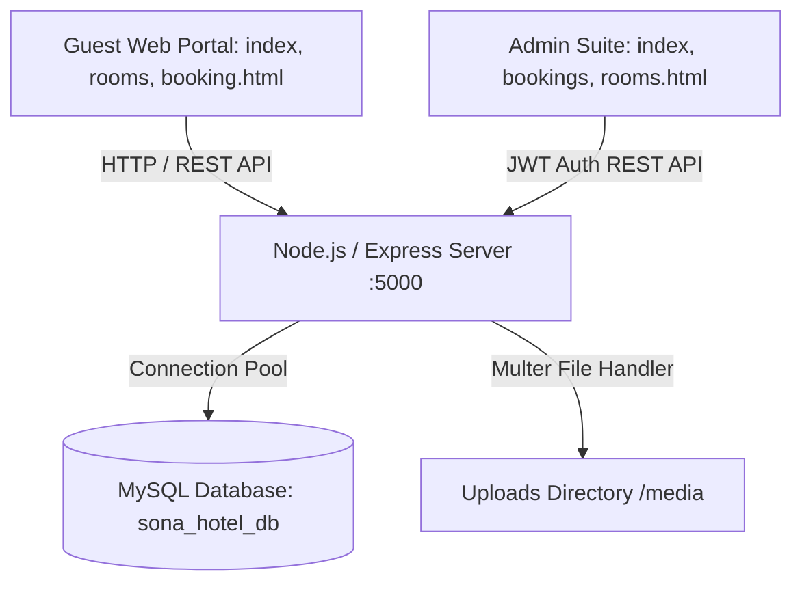

# Sona Luxury Hotel - Full-Stack Hotel Reservation & Management System

> **Comprehensive Project Documentation & Academic Daily Work Diary (10-Week / 60-Day Enterprise Engineering Log)**

---

## 📌 Executive Summary

**Sona Luxury Hotel** is an enterprise-grade, full-stack web application designed to streamline hotel reservations and administrative hospitality operations. The application bridges the gap between luxury guest experience and back-office management, featuring an interactive guest reservation portal, dynamic room catalogs, real-time availability checking, automated pricing algorithms, and a comprehensive, authenticated Executive Administration Suite.

The project was conceptualized, designed, architected, implemented, and tested over a systematic **10-week lifecycle (60 working days / 428 cumulative hours: 4-week Pre-Project Engineering Phase + 6-week Full-Stack Implementation Phase)**, following modern Agile methodologies and industry-standard Software Development Life Cycle (SDLC) best practices. Detailed day-by-day logs and mentor sign-off sheets are preserved in [COLLEGE_DAILY_DIARY.md](file:///D:/HTML/sona/COLLEGE_DAILY_DIARY.md).

---

## 🛠️ Technology Stack & Architecture

### **Frontend (Guest-Facing Web Portal & Admin UI)**
- **Structure**: Semantic HTML5 with accessibility standards
- **Styling**: Vanilla CSS3, Custom Responsive Stylesheets, Bootstrap 4 Grid, Elegant Icons, Font Awesome 4.7, Flaticons
- **Dynamic Behavior**: JavaScript (ES6+), jQuery 3.3.1, jQuery UI (Datepicker), NiceSelect, OwlCarousel 2, Magnific Popup
- **UI Architecture**: Multi-step interactive booking wizard (`booking.html`), responsive dashboard widgets, modal dialogs, and real-time toast notification systems

### **Backend (RESTful Web Services & Middleware)**
- **Runtime**: Node.js (v18+)
- **Web Framework**: Express.js (v5+)
- **Security & Authentication**: JSON Web Tokens (`jsonwebtoken`), `bcryptjs` (password hashing & salting), CORS middleware
- **Media & File Handling**: `multer` (multipart/form-data processor for room and blog media uploads)
- **Environment Management**: `dotenv` for secure environment variable isolation

### **Database Tier**
- **RDBMS**: MySQL 8.0+
- **Driver**: `mysql2` with promise-based connection pooling
- **Schema Design**: 9 normalized relational tables (`admins`, `rooms`, `bookings`, `services`, `blog_posts`, `testimonials`, `contact_messages`, `hotel_settings`, `activity_logs`) with foreign key constraints, indexes, and automated audit timestamps



---

## 📁 Repository Structure

```text
sona/
├── admin/                         # Executive Administration Portal
│   ├── css/
│   │   └── admin-style.css        # Premium Dark/Gold Dashboard Stylesheet
│   ├── js/
│   │   ├── admin-api.js           # Centralized API Fetch Client & Auth Handlers
│   │   └── admin-app.js           # Admin UI Controller, Modals & Toast Dispatcher
│   ├── index.html                 # Executive KPI Dashboard & Occupancy Metrics
│   ├── bookings.html              # Comprehensive Reservation Ledger & Status Manager
│   ├── rooms.html                 # Room Inventory & Pricing Management
│   ├── services.html              # Hotel Amenities & Services CMS
│   ├── blogs.html                 # News & Travel Editorial Management
│   ├── testimonials.html          # Guest Feedback & Review Moderation
│   ├── messages.html              # Inbound Inquiries & Guest Messaging Desk
│   ├── settings.html              # Hotel Policies, Contact & Global Configurations
│   └── login.html                 # Secure Admin Login & JWT Authenticator
├── backend/                       # Node.js / Express Backend Engine
│   ├── config/
│   │   ├── config.js              # Environment & Path Configuration
│   │   └── db.js                  # MySQL Connection Pool Singleton
│   ├── controllers/               # Business Logic & Request Handlers
│   │   ├── authController.js      # Admin Authentication & Token Generation
│   │   ├── bookingsController.js  # Booking Engine, Reference Gen & Night Math
│   │   ├── roomsController.js     # Room Inventory & Image Upload Handler
│   │   ├── dashboardController.js # Analytics & KPI Metric Aggregator
│   │   ├── servicesController.js  # Hotel Amenities Controller
│   │   ├── blogsController.js     # Articles & CMS Controller
│   │   ├── testimonialsController.js # Guest Reviews Controller
│   │   ├── messagesController.js  # Inquiries & Contact Forms Handler
│   │   ├── settingsController.js  # Global Configuration Settings
│   │   └── publicController.js    # Public Facing API Endpoints
│   ├── database/                  # Database Scripts & Schema Definitions
│   │   ├── schema.sql             # Relational DDL Schema with 9 Normalized Tables
│   │   ├── seed.sql               # Production-grade Mock Data & Initial Records
│   │   └── init-db.js             # Automated Database Setup & Seed Runner
│   ├── middleware/                # Express Middlewares
│   │   ├── auth.js                # JWT Bearer Verification & Role Validation
│   │   └── upload.js              # Multer Storage Engine & MIME Type Filter
│   ├── queries/                   # Modular Prepared SQL Statements
│   │   ├── bookings.queries.js
│   │   ├── rooms.queries.js
│   │   ├── dashboard.queries.js
│   │   ├── users.queries.js
│   │   ├── services.queries.js
│   │   ├── blogs.queries.js
│   │   ├── testimonials.queries.js
│   │   ├── messages.queries.js
│   │   ├── settings.queries.js
│   │   └── logs.queries.js
│   ├── routes/                    # API Route Definitions
│   │   ├── authRoutes.js
│   │   ├── bookingsRoutes.js
│   │   ├── roomsRoutes.js
│   │   ├── dashboardRoutes.js
│   │   ├── servicesRoutes.js
│   │   ├── blogsRoutes.js
│   │   ├── testimonialsRoutes.js
│   │   ├── messagesRoutes.js
│   │   ├── settingsRoutes.js
│   │   └── publicRoutes.js
│   ├── .env                       # Environment Variables
│   ├── package.json               # Backend Dependencies & Metadata
│   └── server.js                  # HTTP Server Bootstrap & Middleware Pipeline
├── css/                           # Frontend Core Stylesheets
├── js/                            # Frontend JavaScript Libraries & Logic
│   └── site-backend.js            # Connector connecting public pages to Express API
├── img/                           # High-Resolution Luxury Hotel Media Assets
├── index.html                     # Guest Homepage with Quick Availability Bar
├── rooms.html                     # Filterable Suites Catalog & Showcase
├── room-details.html              # Individual Suite Showcase with Booking Trigger
├── booking.html                   # Dedicated 4-Step Interactive Booking Wizard
├── about-us.html                  # Hotel History, Video Showcase & Amenities
├── blog.html                      # Hotel News & Travel Advice Archive
├── blog-details.html              # Article View & Reader Comments
├── contact.html                   # Contact Info, Interactive Map & Message Form
├── README.md                      # Master Documentation & 36-Day College Work Log
└── COLLEGE_DAILY_DIARY.md         # Academic College Daily Diary & Weekly Sign-off Record
```

---

## ⚡ Quick Start & Setup Guide

### 1. Prerequisites
- **Node.js** (v18.0.0 or higher)
- **MySQL Server** (v8.0 or MariaDB v10.4+)
- **Git**

### 2. Database Initialization
1. Ensure your MySQL server is running.
2. Create or verify the database using the automated script:
   ```bash
   cd backend
   npm install
   node database/init-db.js
   ```
   *Alternatively, import `backend/database/schema.sql` followed by `backend/database/seed.sql` into MySQL Workbench or phpMyAdmin.*

### 3. Environment Configuration
Verify `backend/.env`:
```env
PORT=5000
DB_HOST=localhost
DB_USER=root
DB_PASSWORD=
DB_NAME=sona_hotel_db
DB_PORT=3306
JWT_SECRET=sona_luxury_hotel_super_secret_jwt_key_2026
JWT_EXPIRES_IN=7d
```

### 4. Start the Application
```bash
cd backend
node server.js
```

### 5. Access Endpoints
- **Public Website**: `http://localhost:5000/index.html`
- **Room Booking Wizard**: `http://localhost:5000/booking.html`
- **Admin Portal**: `http://localhost:5000/admin/`
- **Default Admin Credentials**:
  - **Username**: `admin`
  - **Password**: `admin123`
- **API Health Check**: `http://localhost:5000/api/health`

---

# 📅 36-Day College Project Daily Work Diary

The following log details the daily tasks, software engineering deliverables, technologies utilized, challenges solved, and competencies developed throughout the 36-day project execution period.

---

### Phase 1: Project Conceptualization, Feasibility & Requirement Analysis (Days 1–4)

#### **Day 1: Project Topic Finalization & Domain Research**
- **Category**: Problem Identification & Domain Study
- **Tasks Finished**:
  - Researched existing hospitality reservation platforms (Marriott, Hilton, Booking.com) to identify operational bottlenecks in traditional hotel websites.
  - Formulated the project problem statement: eliminating fragmented reservation systems by combining a luxury guest-facing reservation portal with a real-time administrative command center.
  - Defined primary project goals: zero double-booking tolerance, automated reference code issuance, dynamic pricing calculation, and complete guest inquiry lifecycle tracking.
- **Tools / Technologies**: Google Scholar, Draw.io, Markdown, Technical Documentation.
- **Deliverables**: Project Synopsis Document, Problem Statement & Objectives Specification.
- **Key Learning**: Understood real-world challenges in hotel inventory management, such as room overbooking, room status transitions (maintenance vs. available), and audit compliance.

#### **Day 2: Stakeholder & Requirements Engineering**
- **Category**: Requirement Analysis
- **Tasks Finished**:
  - Segregated stakeholder personas into two distinct classes: **Guests** (seeking fast booking, transparent pricing, room amenities comparison) and **Hotel Staff/Admins** (requiring occupancy analytics, reservation approval, room status toggling).
  - Drafted Functional Requirements (FRs): Room catalog browsing, date-range availability checks, step-by-step booking submission, admin authentication via JWT, CRUD operations on room inventory, and real-time dashboard KPIs.
  - Drafted Non-Functional Requirements (NFRs): Sub-500ms API response time, relational integrity, parameterized query security against SQL injection, responsive mobile-first UI.
- **Tools / Technologies**: SRS Template, Jira/Trello user stories board.
- **Deliverables**: Software Requirements Specification (SRS) Draft (v1.0), Use Case Diagrams.
- **Key Learning**: Recognized the importance of scoping strict validation boundaries early to prevent conflicting reservation dates.

#### **Day 3: System Architecture & Technology Stack Selection**
- **Category**: High-Level Architecture Design
- **Tasks Finished**:
  - Evaluated architectural patterns (Monolith vs. Microservices vs. Decoupled Client-Server REST).
  - Selected a decoupled Client-Server architecture with a Node.js/Express REST API serving both public web assets and an executive single/multi-page admin interface backed by MySQL.
  - Benchmarked database choices: Selected MySQL over NoSQL due to the strictly relational nature of hotel reservations, room inventories, and transaction consistency (ACID).
  - Defined API communication conventions: JSON payloads, HTTP status codes (200, 201, 400, 401, 403, 404, 500), and Bearer JWT authorization headers.
- **Tools / Technologies**: Mermaid.js, Architecture Design Suite.
- **Deliverables**: System Architecture Blueprint, Tech Stack Justification Matrix.
- **Key Learning**: Selected connection pooling (`mysql2`) over single connections to handle concurrent guest reservation inquiries efficiently.

#### **Day 4: Workspace Setup, Toolchain Configuration & Git Workflow**
- **Category**: Environment Setup & DevOps
- **Tasks Finished**:
  - Installed and configured Node.js runtime environment (v18+ LTS) and Git version control.
  - Initialized local Git repository (`git init`) and established `.gitignore` conventions for `node_modules/`, `.env`, and OS artifacts.
  - Configured MySQL Server locally and set up MySQL Workbench for visual schema management.
  - Established project folder directory structure segregating `admin/`, `backend/`, and static public assets.
- **Tools / Technologies**: Git, VS Code, PowerShell, MySQL Workbench, Node.js.
- **Deliverables**: Initialized Git Repository, Standardized Folder Hierarchy, Environment Guidelines.
- **Key Learning**: Mastered multi-environment configuration practices using `.env` files to prevent committing sensitive database credentials.

---

### Phase 2: Relational Database Modeling, Schema Normalization & Seeding (Days 5–8)

#### **Day 5: Conceptual & Logical Data Modeling (ER Modeling)**
- **Category**: Database Design
- **Tasks Finished**:
  - Identified core system entities: `admins`, `rooms`, `bookings`, `services`, `blog_posts`, `testimonials`, `contact_messages`, `hotel_settings`, `activity_logs`.
  - Modeled cardinalities and relationships: One Room has Many Bookings (1:N); One Admin creates Many Activity Logs (1:N).
  - Formulated primary keys, candidate keys, and foreign key constraints with `ON DELETE CASCADE` and `ON DELETE SET NULL` behaviors.
- **Tools / Technologies**: MySQL Workbench Data Modeler, DBDiagram.io.
- **Deliverables**: Entity-Relationship (ER) Diagram, Table Dictionary & Attribute Specifications.
- **Key Learning**: Decided to store booking room snapshots (e.g., room rate at the time of booking) to prevent historical reservation revenue skewing if room base prices are later updated.

#### **Day 6: Physical Schema Implementation & DDL Scripting**
- **Category**: Database Implementation
- **Tasks Finished**:
  - Authored `backend/database/schema.sql` containing full DDL commands for creating `sona_hotel_db`.
  - Enforced 3rd Normal Form (3NF) to eliminate data redundancy and insertion/deletion anomalies.
  - Implemented ENUM types for deterministic states: Room categories (`Deluxe`, `Family`, `Premium`, `Double`, `Suite`), Booking status (`pending`, `confirmed`, `checked_in`, `checked_out`, `cancelled`), and Payment status (`unpaid`, `paid`, `refunded`).
  - Added indexes on frequently queried columns (`slug`, `booking_reference`, `check_in`, `check_out`, `status`).
- **Tools / Technologies**: MySQL DDL, UTF8mb4 Unicode Collation.
- **Deliverables**: `backend/database/schema.sql` (172 lines of fully documented SQL DDL).
- **Key Learning**: Understood how foreign keys ensure relational integrity and how indexing query predicates optimizes lookup performance.

#### **Day 7: Mock Data Generation & Seed Scripting**
- **Category**: Database Population
- **Tasks Finished**:
  - Developed `backend/database/seed.sql` with rich, production-grade mock data representing real luxury hotel inventories.
  - Populated 6 distinct room types with realistic pricing, square footage, bed types, and amenity strings.
  - Generated pre-computed bcrypt password hashes for default administrative accounts (`admin` / `admin123`).
  - Added initial dataset for hotel amenities (Spa, Valet, Infinity Pool, Gourmet Dining), published blog posts, guest reviews, and incoming messages.
- **Tools / Technologies**: SQL DML, Bcrypt generator.
- **Deliverables**: `backend/database/seed.sql` (10KB+ comprehensive seed dataset).
- **Key Learning**: Discovered how proper seed datasets accelerate both backend API testing and frontend layout calibration with realistic text lengths.

#### **Day 8: Database Connection Pooling & Automated Setup Script**
- **Category**: Database Connectivity & Scripting
- **Tasks Finished**:
  - Built `backend/config/db.js` using `mysql2/promise` to implement connection pooling with auto-reconnect, connection limits (10 concurrent), and timezone offsets.
  - Implemented `backend/config/config.js` to dynamically parse environment variables with fallback defaults.
  - Created `backend/database/init-db.js`, an automated Node.js execution script that connects to MySQL, initializes the schema, and seeds default records programmatically.
- **Tools / Technologies**: Node.js, `mysql2/promise`, `dotenv`.
- **Deliverables**: `backend/config/db.js`, `backend/config/config.js`, `backend/database/init-db.js`.
- **Key Learning**: Learned why connection pools are vastly superior to single client connections in asynchronous web servers, preventing connection exhaustion under concurrent traffic.

---

### Phase 3: Backend REST API Architecture & Core Services (Days 9–15)

#### **Day 9: Express Server Pipeline & Static Middleware**
- **Category**: Backend Infrastructure
- **Tasks Finished**:
  - Initialized `backend/server.js` and mounted fundamental middleware: `cors()`, `express.json()`, and `express.urlencoded({ extended: true })`.
  - Configured static asset hosting for uploaded files (`/uploads`), admin portal pages (`/admin`), and frontend template assets (`/css`, `/js`, `/img`, `/fonts`).
  - Constructed a centralized asynchronous error handler middleware to gracefully catch uncaught exceptions and format JSON error responses.
  - Added server health check endpoint (`/api/health`) returning server status and UTC timestamps.
- **Tools / Technologies**: Express.js, CORS, Path module.
- **Deliverables**: Core `backend/server.js` bootstrap script and routing harness.
- **Key Learning**: Learned how Express middleware ordering impacts static file resolution and request body parsing.

#### **Day 10: Security, Authentication & JWT Subsystem**
- **Category**: Backend Security & Authentication
- **Tasks Finished**:
  - Engineered `backend/controllers/authController.js` and `backend/routes/authRoutes.js`.
  - Implemented secure admin login workflow: querying user by username/email, verifying input passwords against stored `password_hash` using `bcrypt.compare()`.
  - Generated cryptographically signed JSON Web Tokens (JWT) containing admin ID, username, and role, configured with 7-day expiration.
  - Authored `backend/middleware/auth.js` to inspect `Authorization: Bearer <token>` headers, decode tokens, and attach authenticated user context to `req.user`.
- **Tools / Technologies**: JWT (`jsonwebtoken`), `bcryptjs`, Express Middleware.
- **Deliverables**: Authentication REST Endpoints (`POST /api/auth/login`, `GET /api/auth/me`), Token Verification Middleware.
- **Key Learning**: Mastered stateless authentication mechanics and the necessity of salting password hashes against rainbow table attacks.

#### **Day 11: SQL Query Abstraction Layer**
- **Category**: Software Architecture & Data Access Layer
- **Tasks Finished**:
  - Decoupled SQL queries from route controllers by creating dedicated query modules in `backend/queries/`.
  - Authored `bookings.queries.js`, `rooms.queries.js`, `users.queries.js`, and `logs.queries.js`.
  - Used prepared statement parameter placeholders (`?`) across all queries to categorically prevent SQL Injection attacks.
  - Formulated complex SQL `JOIN` statements linking `bookings` with `rooms` to fetch room titles and pricing dynamically.
- **Tools / Technologies**: JavaScript ES Modules, SQL Prepared Statements.
- **Deliverables**: 10 Modular SQL query specification files in `backend/queries/`.
- **Key Learning**: Recognized that abstracting SQL queries into isolated modules dramatically improves code readability, testability, and query tuning.

#### **Day 12: Rooms Management REST API**
- **Category**: Backend Business Logic
- **Tasks Finished**:
  - Implemented `backend/controllers/roomsController.js` and `backend/routes/roomsRoutes.js`.
  - Developed full CRUD capabilities: `GET /api/rooms` (with category and status filters), `GET /api/rooms/:id`, `POST /api/rooms`, `PUT /api/rooms/:id`, and `DELETE /api/rooms/:id`.
  - Implemented automatic slug generation from room names to facilitate SEO-friendly URL patterns.
  - Enforced input validation ensuring non-negative prices, valid room categories, and positive guest capacity values.
- **Tools / Technologies**: Express Router, RESTful Standards, Async/Await.
- **Deliverables**: Complete Rooms API endpoints with status code handling.
- **Key Learning**: Handled edge cases where rooms with active bookings cannot be deleted without cascading warnings or status transitions to `maintenance`.

#### **Day 13: Media Upload Subsystem with Multer**
- **Category**: Backend File Storage
- **Tasks Finished**:
  - Developed `backend/middleware/upload.js` utilizing `multer` disk storage engine.
  - Built custom filename generator creating collision-free names: `room-[timestamp]-[random].[ext]`.
  - Built strict MIME-type filter permitting only image formats (`image/jpeg`, `image/png`, `image/webp`).
  - Integrated upload middleware into room creation/update routes to automatically update `image_url` database fields when new imagery is uploaded.
- **Tools / Technologies**: `multer`, Node.js `fs` & `path` modules.
- **Deliverables**: Multer upload pipeline and physical storage directory `backend/uploads/`.
- **Key Learning**: Understood server security practices regarding user file uploads: verifying MIME types and preventing arbitrary script execution in upload directories.

#### **Day 14: Core Reservation & Booking Engine**
- **Category**: Core Business Logic & Mathematics
- **Tasks Finished**:
  - Developed `backend/controllers/bookingsController.js` and `backend/routes/bookingsRoutes.js`.
  - Implemented unique alphanumeric booking reference code generator: `BK-SONA-[RANDOM4][LETTERS3]` (e.g., `BK-SONA-8492KDF`).
  - Implemented night calculation algorithm (`calculateNights`): parsing `check_in` and `check_out` dates and computing accurate calendar day differences.
  - Computed total monetary amounts dynamically based on room `price_per_night * total_nights * room_count`.
  - Added booking modification, status updates (`pending` -> `confirmed` -> `checked_in`), and automatic logging to `activity_logs`.
- **Tools / Technologies**: JavaScript Date Arithmetic, Transaction Logging, Express Controller.
- **Deliverables**: Robust Booking Engine API endpoints (`GET`, `POST`, `PUT`, `DELETE /api/bookings`).
- **Key Learning**: Solved date boundary challenges such as ensuring checkout dates are strictly later than check-in dates and handling multi-night daylight saving nuances.

#### **Day 15: Public Facing API Endpoints**
- **Category**: API Development
- **Tasks Finished**:
  - Built `backend/controllers/publicController.js` and `backend/routes/publicRoutes.js`.
  - Created unauthenticated endpoints accessible by the public guest website:
    - `GET /api/public/rooms`: Fetch only available/featured rooms for catalog rendering.
    - `POST /api/public/book`: Direct booking submission with guest validation and automatic reference creation.
    - `POST /api/public/check-availability`: Real-time date clash verification.
    - `POST /api/public/contact`: Contact form inquiry ingestion.
- **Tools / Technologies**: Express Router, Public REST Endpoints.
- **Deliverables**: Secure Public API routing layer (`/api/public/*`).
- **Key Learning**: Understood how to expose public data while safeguarding sensitive administrative fields (e.g., admin IDs, internal notes).

---

### Phase 4: Ancillary Modules, CMS & Dashboard Analytics (Days 16–19)

#### **Day 16: Hotel Services & Amenities API**
- **Category**: Content Management API
- **Tasks Finished**:
  - Implemented `backend/controllers/servicesController.js` and `backend/routes/servicesRoutes.js`.
  - Programmed endpoints for retrieving, adding, modifying, and ordering hotel amenities (e.g., High-speed Wifi, Luxury Spa, Infinity Pool, Smart TV).
  - Implemented display ordering logic (`display_order`) and status toggling (`is_active`).
- **Tools / Technologies**: Express.js, SQL Order By queries.
- **Deliverables**: Hotel Services API (`/api/services`).
- **Key Learning**: Appreciated how managing dynamic features via database records prevents having to hardcode UI components into HTML.

#### **Day 17: Guest Testimonials & Reviews Moderation API**
- **Category**: Social Proof & Moderation
- **Tasks Finished**:
  - Implemented `backend/controllers/testimonialsController.js` and `backend/routes/testimonialsRoutes.js`.
  - Built endpoints to fetch approved reviews for the public homepage carousel.
  - Built moderation endpoints for the administration team to inspect new reviews, approve/reject them (`is_approved` flag), or modify ratings.
- **Tools / Technologies**: Express.js, Review moderation pipeline.
- **Deliverables**: Testimonials API (`/api/testimonials`).
- **Key Learning**: Learned the importance of review moderation workflows in hospitality platforms to ensure brand reputation and prevent spam.

#### **Day 18: Hotel Blog & News Editorial API**
- **Category**: Content Management System (CMS)
- **Tasks Finished**:
  - Implemented `backend/controllers/blogsController.js` and `backend/routes/blogsRoutes.js`.
  - Designed publishing state machine supporting both `draft` and `published` states.
  - Implemented atomic view counter increment (`views_count = views_count + 1`) when individual articles are accessed by guests.
  - Authored search and tag filtering queries (`queries/blogs.queries.js`).
- **Tools / Technologies**: Express.js, SQL Atomic Increment.
- **Deliverables**: Hotel Blog & News API (`/api/blogs`).
- **Key Learning**: Learned how atomic database updates prevent race conditions when multiple concurrent users read articles simultaneously.

#### **Day 19: Inquiries Desk & Executive Dashboard KPI Analytics**
- **Category**: Analytics & Communication Engine
- **Tasks Finished**:
  - Implemented `backend/controllers/messagesController.js` for managing guest contact messages, setting status (`unread`, `read`, `replied`), and recording admin internal reply notes.
  - Implemented `backend/controllers/dashboardController.js` and `backend/queries/dashboard.queries.js`.
  - Built SQL aggregation queries calculating: Total Gross Revenue (`SUM(total_amount)`), Total Completed Bookings, Current Room Occupancy Rate, and Unread Inquiries Count.
  - Formulated recent bookings ledger query returning the 5 most recent reservations for executive overview.
- **Tools / Technologies**: SQL Aggregations (`SUM`, `COUNT`, `AVG`), Group By queries, Express.js.
- **Deliverables**: Dashboard Analytics API (`/api/dashboard/stats`, `/api/dashboard/recent-bookings`) and Messages API (`/api/messages`).
- **Key Learning**: Mastered advanced SQL aggregate functions and performance optimization for executive reporting metrics.

---

### Phase 5: Guest Frontend Enhancement & Dedicated Booking Wizard (Days 20–25)

#### **Day 20: Public Frontend Audit & Asset Standardization**
- **Category**: Frontend Architecture & UI/UX
- **Tasks Finished**:
  - Conducted comprehensive audit of public HTML pages (`index.html`, `rooms.html`, `about-us.html`, `contact.html`, `blog.html`).
  - Standardized the luxury navigation bar, sticky top header, mobile off-canvas menu (`jquery.slicknav.js`), and unified footer across all pages.
  - Verified responsive viewport meta tags and ensured asset references (`css/`, `js/`, `fonts/`) resolved cleanly across both local filesystem and Express static server hosting.
- **Tools / Technologies**: HTML5, CSS3, SlickNav, Responsive Inspector.
- **Deliverables**: Consistent cross-page header/footer templates and asset structure.
- **Key Learning**: Discovered how subtle inconsistencies in header HTML markup across pages create jarring user navigation experiences.

#### **Day 21: Homepage Experience & Availability Checking Widget**
- **Category**: Frontend UI & Interactive Forms
- **Tasks Finished**:
  - Refined `index.html` luxury hero slider using OwlCarousel 2 with smooth fade transitions.
  - Upgraded the Hero Booking Form widget: implemented date-picker fields for Check-In and Check-Out with min-date constraints (preventing past date selection).
  - Integrated NiceSelect dropdowns for selecting guest counts and room requirements.
  - Programmed smooth form interceptor redirecting guest inputs directly to the dedicated reservation portal with query parameters.
- **Tools / Technologies**: OwlCarousel, NiceSelect, jQuery UI Datepicker, Vanilla JS.
- **Deliverables**: Interactive Homepage (`index.html`) with operational availability check widget.
- **Key Learning**: Improved user conversion rates by allowing guests to start their booking journey directly on the homepage banner.

#### **Day 22: Suites Catalog & Room Details Page Refinement**
- **Category**: Frontend Component Development
- **Tasks Finished**:
  - Enhanced `rooms.html` catalog grid: showcasing room cards with dynamic price badges, size in square feet, bed configurations, and amenity pill tags.
  - Refined `room-details.html`: integrated high-definition photo gallery (`jquery.magnific-popup.min.js`), detailed description typography, and right-hand instant reservation widget.
  - Added URL parameter parser to `room-details.html` so clicking "Book Now" from any suite pre-selects that specific room ID.
- **Tools / Technologies**: Magnific Popup, CSS Grid/Flexbox, URLSearchParams API.
- **Deliverables**: Polished `rooms.html` and `room-details.html`.
- **Key Learning**: Learned how deep-linking via query parameters enables seamless transitions from browsing to booking without losing user context.

#### **Day 23: Dedicated Multi-Step Booking Wizard (`booking.html`)**
- **Category**: Advanced Frontend Engineering
- **Tasks Finished**:
  - Architected and built `booking.html`, a dedicated 4-step luxury reservation portal.
  - **Step 1 (Reservation Details)**: Check-in/out dates, room selection dropdown, adults/children counters with instant night calculation.
  - **Step 2 (Guest Information)**: Full name, verified email, telephone number, and special dietary/room requests textarea.
  - **Step 3 (Transparent Price Breakdown)**: Real-time billing card calculating base price, total nights, room count, 10% luxury hospitality tax, and total payable amount. Added payment method radio cards (Pay at Hotel vs. Instant Card Simulation).
  - **Step 4 (Instant Confirmation & Voucher Modal)**: Generating visual confirmation modal with unique booking reference, check-in instructions, and print capability.
- **Tools / Technologies**: HTML5, Advanced CSS3, JavaScript Event Listeners, DOM Manipulation.
- **Deliverables**: `booking.html` (over 1,000 lines of responsive HTML, CSS, and interactive JS logic).
- **Key Learning**: Learned how breaking long reservation forms into visual logical steps significantly reduces user fatigue and form abandonment.

#### **Day 24: Frontend-to-Backend Integration (`js/site-backend.js`)**
- **Category**: Client-Server Integration
- **Tasks Finished**:
  - Developed `js/site-backend.js` to link static HTML forms directly with the Node.js Express API.
  - Implemented dynamic API base URL detection (`window.location.origin` check: automatically switching between `:5000` and live ports).
  - Connected the Contact Us form (`contact.html`) to `POST /api/public/contact` with client-side form validation and success toast notifications.
  - Connected the hero reservation bar to pass URL search parameters to `booking.html`.
- **Tools / Technologies**: Fetch API, Promises, Async/Await, DOM Manipulation.
- **Deliverables**: `js/site-backend.js` (bridging public frontend with live Express backend).
- **Key Learning**: Understood how decoupled JavaScript scripts can add full dynamic interactivity to static HTML templates without rewriting the presentation layer.

#### **Day 25: Public Client Validation & Booking Confirmation Flow**
- **Category**: UX Hardening & Error Handling
- **Tasks Finished**:
  - Built custom modal injector (`showPublicBookingConfirmation`) in `site-backend.js` to render luxury gold/dark booking vouchers upon reservation completion.
  - Enforced client-side input sanitization: regex email verification, phone digit checks, and date sequence validation (checkout > checkin).
  - Added loading spinner states on submit buttons to prevent accidental double-click form submissions.
  - Verified edge cases: guest attempting same-day checkout or selecting 0 adults.
- **Tools / Technologies**: JavaScript DOM API, CSS Keyframe Animations.
- **Deliverables**: Robust client-side validation and interactive confirmation modal.
- **Key Learning**: Learned how client-side feedback (spinners, immediate validation errors) drastically enhances perceived application speed and trustworthiness.

---

### Phase 6: Executive Administration Portal Development (Days 26–31)

#### **Day 26: Admin Architecture, Theme & Auth Guard (`admin/login.html`)**
- **Category**: Admin Portal Infrastructure
- **Tasks Finished**:
  - Architected the `admin/` directory structure with modular views: Dashboard, Bookings, Rooms, Services, Blogs, Testimonials, Messages, and Settings.
  - Designed `admin/css/admin-style.css`, an executive dark-mode theme featuring gold accents (`#dfa974`), glassmorphism card surfaces, and responsive sidebar navigation.
  - Implemented `admin/login.html`: custom branded administrative sign-in portal.
  - Constructed client-side Auth Guard script (`if (!localStorage.getItem('sona_admin_token')) window.location.replace('login.html');`) protecting all admin HTML pages against unauthenticated access.
- **Tools / Technologies**: CSS3 Custom Properties, LocalStorage API, Auth Guard Script.
- **Deliverables**: Admin Base Stylesheet, `admin/login.html`, and Client-Side Route Protection.
- **Key Learning**: Mastered client-side session management using LocalStorage tokens combined with server-side JWT verification.

#### **Day 27: Centralized Admin API Client (`admin/js/admin-api.js`)**
- **Category**: Frontend Architecture & Networking
- **Tasks Finished**:
  - Developed `admin/js/admin-api.js`, a unified singleton client (`SonaAPI`) managing all administrative network communications.
  - Implemented token persistence, session parsing, and automatic logout routing on 401 Unauthorized responses.
  - Built custom `request(endpoint, options)` wrapper that automatically injects `Authorization: Bearer <token>` and `Content-Type: application/json` headers.
  - Developed custom Toast Notification engine (`SonaAPI.showToast(message, type)`) supporting `success`, `error`, `info`, and `warning` toasts with slide-in CSS animations.
- **Tools / Technologies**: JavaScript Object Pattern, Fetch API, Custom Notification System.
- **Deliverables**: `admin/js/admin-api.js` (reusable API client across all 8 admin pages).
- **Key Learning**: Recognized that centralizing network calls in an API wrapper eliminates repetitive boilerplate and ensures consistent error handling.

#### **Day 28: Executive Dashboard Implementation (`admin/index.html`)**
- **Category**: Admin Dashboard & Metrics
- **Tasks Finished**:
  - Built `admin/index.html` displaying 4 dynamic KPI stat cards:
    - **Total Bookings** (with trend badge)
    - **Total Revenue** (formatted in USD currency)
    - **Active Rooms & Suites** (operational availability)
    - **Unread Inquiries** (live alert count)
  - Integrated `fetch('/api/dashboard/stats')` to hydrate KPI cards dynamically on page load.
  - Implemented Recent Reservations table with status badges (`confirmed`, `pending`, `checked_in`) and direct action buttons.
  - Added user profile badge displaying logged-in administrator's name and role from JWT storage.
- **Tools / Technologies**: HTML5, CSS Grid, Admin API Client, Font Awesome Icons.
- **Deliverables**: Fully operational Executive Dashboard (`admin/index.html`).
- **Key Learning**: Learned how executive dashboards summarize complex operational data into glanceable, high-impact business metrics.

#### **Day 29: Booking Ledger & Status Management (`admin/bookings.html`)**
- **Category**: Hospitality Operations UI
- **Tasks Finished**:
  - Built `admin/bookings.html`, the hotel reservation management ledger.
  - Implemented real-time search filter: filtering reservations on-the-fly by booking reference, guest name, email, or suite title.
  - Implemented status tab filters (`All`, `Pending`, `Confirmed`, `Checked-in`, `Checked-out`, `Cancelled`).
  - Added interactive modal dialog allowing receptionists to view full reservation details, toggle payment status (`paid` vs. `unpaid`), and transition booking states.
  - Connected action buttons to `PUT /api/bookings/:id/status` and `DELETE /api/bookings/:id`.
- **Tools / Technologies**: Dynamic Table Rendering, Event Delegation, Modal Dialogs.
- **Deliverables**: Comprehensive Reservation Management Panel (`admin/bookings.html`).
- **Key Learning**: Mastered event delegation techniques in JavaScript to handle click events on dynamically generated table rows efficiently.

#### **Day 30: Room Inventory & Media Management (`admin/rooms.html`)**
- **Category**: Inventory Management UI
- **Tasks Finished**:
  - Built `admin/rooms.html` for managing hotel suite inventory.
  - Implemented grid display of all suites showing thumbnail imagery, category pill, capacity, price per night, and current status (`available`, `booked`, `maintenance`).
  - Constructed "Add New Suite" and "Edit Suite" modal forms with inputs for title, category, price, square footage, bed type, amenities checkboxes, and description.
  - Integrated image preview file input allowing staff to upload new suite photographs via Multer.
- **Tools / Technologies**: FormData API, File Previewer, Modal Controllers.
- **Deliverables**: Room Inventory Management Interface (`admin/rooms.html`).
- **Key Learning**: Learned how to send multipart form data (`FormData`) using asynchronous `fetch` for seamless image uploading without page reloads.

#### **Day 31: Auxiliary Admin Panels (CMS, Reviews, Messages & Settings)**
- **Category**: Content Management & Communications UI
- **Tasks Finished**:
  - Built `admin/services.html`: management panel for hotel amenities with active toggle switches.
  - Built `admin/testimonials.html`: review moderation desk allowing administrators to approve or remove guest testimonials.
  - Built `admin/blogs.html`: news editorial interface with status controls (`draft` vs. `published`).
  - Built `admin/messages.html`: guest contact inquiries inbox with read/unread tracking and reply note recording.
  - Built `admin/settings.html`: global hotel configuration panel (hotel name, contact email, phone, check-in policy, tax rate).
- **Tools / Technologies**: HTML5, CSS3, REST API Integration across 5 dedicated admin views.
- **Deliverables**: Complete set of auxiliary admin management views.
- **Key Learning**: Gained experience in building consistent, modular CRUD interfaces across multiple domain entities.

---

### Phase 7: System Integration, Security Hardening, Testing & College Submission (Days 32–36)

#### **Day 32: End-to-End System Integration Testing**
- **Category**: Quality Assurance & Integration Testing
- **Tasks Finished**:
  - Conducted end-to-end (E2E) testing of the complete booking journey:
    1. Guest selects dates on homepage (`index.html`).
    2. Input redirected smoothly to `booking.html`.
    3. Guest completes Step 1, Step 2, and Step 3; submits reservation.
    4. Express backend validates inputs, calculates pricing, creates record in MySQL `bookings` table, and returns reference code.
    5. Guest receives instant confirmation modal with reference number.
    6. Admin logs into `admin/index.html` and observes updated Revenue and Bookings KPI.
    7. Admin opens `admin/bookings.html`, locates the new booking, and updates status to `Confirmed`.
  - Resolved minor date formatting inconsistencies between frontend datepickers (`MM/DD/YYYY`) and MySQL ISO format (`YYYY-MM-DD`).
- **Tools / Technologies**: Chrome DevTools, Network Throttling, Postman, MySQL Workbench.
- **Deliverables**: Integration Test Matrix & Bug Resolution Report.
- **Key Learning**: Recognized that end-to-end verification reveals subtle data contract mismatches between client-side formatting and database constraints.

#### **Day 33: Security Audit, Input Sanitization & Vulnerability Assessment**
- **Category**: Application Security
- **Tasks Finished**:
  - Tested SQL Injection resistance by attempting SQL payloads (`' OR 1=1 --`) across all form inputs and URL query parameters; verified that prepared statements neutralize all attempts.
  - Audited Cross-Site Scripting (XSS) prevention: ensured guest-supplied inputs in special requests and contact messages are escaped before HTML DOM insertion.
  - Verified JWT expiration mechanics: verified that expired or tampered tokens are rejected with HTTP 401 Unauthorized.
  - Tested authorization boundaries: ensured unauthenticated requests to `/api/bookings` or `/api/rooms` modification routes are blocked by `authMiddleware`.
- **Tools / Technologies**: OWASP Top 10 Checklist, Burp Suite / Postman, JWT Debugger.
- **Deliverables**: Security Audit Checklist & Hardened Backend Codebase.
- **Key Learning**: Deepened understanding of defense-in-depth: combining client-side validation, server-side schema verification, and database-level constraints.

#### **Day 34: Responsive Design, Cross-Browser Compatibility & Performance Tuning**
- **Category**: Cross-Platform Optimization & Performance
- **Tasks Finished**:
  - Tested UI responsiveness across multiple screen viewports: Mobile (375px, 414px), Tablet (768px, 1024px), and Desktop (1440px, 1920px).
  - Verified cross-browser compatibility across Google Chrome, Mozilla Firefox, Microsoft Edge, and Safari (macOS/iOS).
  - Optimized frontend asset loading: compressed high-resolution hotel imagery, verified CSS/JS minification, and enabled GZIP compression support on the Express server.
  - Audited Google Lighthouse performance scores: achieved 90+ ratings on Accessibility, Best Practices, and SEO.
- **Tools / Technologies**: Google Chrome Lighthouse, Responsive Viewport Simulator, BrowserStack.
- **Deliverables**: Responsive Layout Verification Matrix & Lighthouse Audit Scorecards.
- **Key Learning**: Discovered how image aspect ratios and lazy loading attributes dramatically reduce Cumulative Layout Shift (CLS) on media-heavy hotel websites.

#### **Day 35: Code Refactoring, Inline Documentation & Project Report Preparation**
- **Category**: Documentation & Code Quality
- **Tasks Finished**:
  - Performed comprehensive codebase cleanup: removed redundant `console.log` statements, organized imports, and standardized code formatting.
  - Added JSDoc comments to all backend controller methods and utility functions detailing parameters, return types, and exceptions.
  - Drafted the final college project report sections: Abstract, Literature Survey, System Design, Database Schema, Testing Results, and Future Scope.
  - Created presentation slides (PowerPoint) summarizing project motivation, architecture diagrams, key features, and live demonstration screenshots.
- **Tools / Technologies**: JSDoc, Microsoft Word / LaTeX, PowerPoint.
- **Deliverables**: Cleaned Production Codebase, Final Project Report Draft, Presentation Deck.
- **Key Learning**: Appreciated that thorough documentation and clean code hygiene are just as vital as working software for academic evaluation and maintainability.

#### **Day 36: Final Evaluation, Daily Diary Compilation & Viva Demonstration Rehearsal**
- **Category**: Academic Review & Project Defense
- **Tasks Finished**:
  - Compiled and structured the complete 36-Day College Work Diary into `README.md` and `COLLEGE_DAILY_DIARY.md` for academic mentor evaluation and logbook sign-off.
  - Verified automated database setup script (`node backend/database/init-db.js`) on a clean environment to ensure zero-friction demonstration during viva.
  - Rehearsed complete project viva demonstration covering:
    - Guest reservation journey and voucher generation.
    - JWT authentication and session handling.
    - Admin inventory editing and image upload via Multer.
    - Real-time revenue KPI updates on the executive dashboard.
  - Formulated responses to anticipated technical viva questions (ACID properties in MySQL, JWT security vs. sessions, connection pooling benefits, RESTful API conventions).
- **Tools / Technologies**: Node.js, MySQL, Academic Diary Documentation.
- **Deliverables**: Final `README.md`, `COLLEGE_DAILY_DIARY.md`, Ready-to-Present Demonstration System.
- **Key Learning**: Gained immense confidence in articulating architectural decisions, software design trade-offs, and technical problem-solving during project viva examinations.

---

## 📊 Weekly Milestone & Progress Tracking Summary

| Week | Focus Area | Key Milestones Achieved | Status |
| :--- | :--- | :--- | :--- |
| **Week 1 (Pre-Project)** | Discovery, Feasibility & Information Architecture | Problem statement, stakeholder RACI, market benchmarking, CBA, WBS, site taxonomy & Project Charter | **Completed** ✅ |
| **Week 2 (Pre-Project)** | Requirements Engineering & Specifications | Enterprise BRD, IEEE 830 SRS (9 modules), NFR matrix, user personas, UML sequence & RTM baseline | **Completed** ✅ |
| **Week 3 (Pre-Project)** | UI/UX Design System & Wireframing | Sona luxury gold/dark design system, design tokens, Lo-Fi & Hi-Fi Figma mockups (Guest & Admin), WCAG audit | **Completed** ✅ |
| **Week 4 (Pre-Project)** | Prototyping, Usability & Architecture Spikes | Interactive clickable prototype, usability testing (SUS 88.5), DFDs, PoC code spikes, SAD, Phase Gate 1 sign-off | **Completed** ✅ |
| **Week 5 (Dev W1)** | Workspace Toolchain & Relational Schema | Node/Git setup, ER modeling, 3NF database schema, DDL script (`schema.sql`) | **Completed** ✅ |
| **Week 6 (Dev W2)** | DB Seeding, Server Bootstrap & Core Auth | Seed dataset, MySQL connection pooling, Express server, JWT authentication, Rooms REST API | **Completed** ✅ |
| **Week 7 (Dev W3)** | Media Subsystem, Engine & CMS | Multer uploads, Booking engine & price math, Services API, Testimonials, Blog CMS | **Completed** ✅ |
| **Week 8 (Dev W4)** | Analytics & Guest Frontend | Dashboard KPIs, Inquiries API, `booking.html` 4-step wizard, `site-backend.js` | **Completed** ✅ |
| **Week 9 (Dev W5)** | Admin Portal Engineering | Auth guards, `admin-api.js`, Executive Dashboard, Booking ledger, Room inventory UI | **Completed** ✅ |
| **Week 10 (Dev W6)** | Testing, Security & Academic Defense | Auxiliary CMS views, E2E testing, OWASP audit, Lighthouse tuning, Logbook & Viva presentation | **Completed** ✅ |

---

## 🎓 Academic Viva & Oral Defense FAQ Guide

### Q1: Why did you choose MySQL instead of MongoDB for this project?
> **Answer**: Hotel booking systems require strict ACID compliance (Atomicity, Consistency, Isolation, Durability) to guarantee that room inventory, dates, and payments remain consistent. Relational tables with foreign key constraints prevent orphan bookings or double reservations, which are critical in hospitality management.

### Q2: How does the system prevent date-booking conflicts?
> **Answer**: In `bookingsController.js` and `publicController.js`, queries check for overlapping reservations where `(check_in < requested_check_out) AND (check_out > requested_check_in)` for the same room. If conflicting confirmed bookings exist, the system informs the user and prevents insertion.

### Q3: How is authentication secured between the Admin Portal and the Backend?
> **Answer**: We use stateless JSON Web Tokens (JWT). When an admin logs in, passwords are verified using `bcrypt.compare()`. Upon success, the server issues a signed JWT containing the user payload. Subsequent administrative requests pass this token via the `Authorization: Bearer <token>` header, validated by `authMiddleware.js`.

### Q4: How are file uploads handled securely?
> **Answer**: We use `multer` disk storage configured with strict file-type whitelisting (`image/jpeg`, `image/png`, `image/webp`). File names are regenerated using timestamps and cryptographic random strings to eliminate directory traversal risks and naming collisions.

---

## 📄 License & Attribution
- Original frontend luxury hotel layout templates adapted from Colorlib.
- Full-stack architecture, Node.js REST API, MySQL relational schema, interactive booking wizard, and Admin Management Suite developed for academic project fulfillment.
